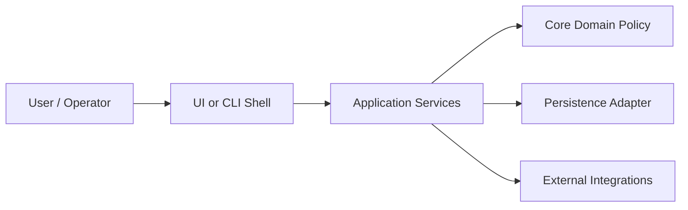

# Architecture Document Structure

Use this structure for `docs/architecture.md`. Adapt names to the repository, but preserve the progressive discovery shape.

## Required Order

1. `# Architecture`
2. `## Project Overview`
   - 1-3 short paragraphs explaining what the project does and who/what uses it.
   - Mention the primary runtime surfaces and durable data at a high level.
3. `## Architecture Overview`
   - Short description of the complete architecture and normal runtime path.
   - Include a compact "product shape" or system-shape list when the system has a small number of major parts.
   - Include a high-level Mermaid component diagram when it clarifies interactions.
   - Keep this diagram broad: user/shell, core/application, persistence, external systems, background jobs, and tests when important.
4. `## Boundaries And Invariants`
   - Capture architectural rules that must remain true, such as source of truth, ownership, identity handles, concurrency rules, and replaceable transport or UI boundaries.
   - Include supported/unsupported environment constraints when they are architectural, not just setup notes.
   - Keep this section grounded in code, durable docs, or clearly labeled inference.
5. `## Repository Mapping`
   - Map major source directories/packages to their architectural roles.
   - State what each area is allowed to depend on and what it must stay free of.
   - Skip this section only when the repository is too small for directory/package mapping to add value.
6. `## Components`
   - Introduce individual components in order of importance to core functionality.
   - For each component, use the same compact pattern:
     - purpose and ownership
     - main responsibilities
     - important collaborators and dependency direction
     - state/data owned or consumed
     - side effects and where they cross boundaries
     - key source paths
     - tests or verification surfaces
   - If a component has meaningful subcomponents, add nested subsections and repeat the pattern at the smaller scale.
7. `## Data And Control Flow`
   - Summarize the most important end-to-end flows.
   - Prefer a second Mermaid sequence or flow diagram only when prose would be ambiguous.
   - Include identity, versioning, stale-write checks, serialization, or security flow details when they are central to correctness.
8. `## Public Surfaces`
   - Document user-facing commands, APIs, routes, protocols, tools, events, or generated local artifacts when present.
   - Link to the source of truth for exhaustive API inventories instead of duplicating long lists that will drift.
   - Explain which surfaces are shells/adapters and which are core behavior.
9. `## Extension Points`
   - Document intended seams for future change only when they are visible in code or durable docs.
   - Distinguish established extension points from aspirational ones.
10. `## Testing And Verification`
   - Summarize test responsibilities by component or boundary.
   - Identify which tests prove core behavior independently of the full system.
   - Mention manual/runtime checks only when they are part of the architecture's risk controls.
11. `## Change Management`
   - List architectural changes that require updating this document alongside code.
   - Keep the list short and based on boundaries that would break users, integrations, stored data, or source-of-truth assumptions.
12. `## Architecture Discussion`
   - Review against local architecture guidance.
   - Cover ownership, coupling, dependency direction, side-effect placement, abstraction quality, interface semantics, and testability.
   - End with the delta between current architecture and architectural vision.

If a repository is small, combine adjacent sections instead of producing empty headings. Do not force sections that cannot be supported by evidence.

## Mermaid Guidance

- Use `flowchart LR` or `flowchart TD` for component diagrams.
- Keep labels short and component-oriented.
- Use quoted labels when text contains punctuation.
- Show dependency/control direction explicitly with arrows.
- Avoid folder-name-only diagrams unless folder layout is the architecture.

Example:

## Component Ordering Heuristic

Order components by this priority:

1. Core model or policy that defines the product's durable behavior.
2. Application services that coordinate the core behavior.
3. Durable storage and data ownership.
4. Primary user/runtime shells.
5. External integrations and adapters.
6. Background workers, schedulers, or automation surfaces.
7. Testing, tooling, and developer-only support.

Adjust when the repository's real architecture makes a later category central to runtime behavior.

## Quality Bar

- Write in terms of architectural responsibilities, not implementation chronology.
- Prefer "X owns Y" and "X must not depend on Y" over vague descriptions.
- Call out unsupported or intentionally narrow environments when the project relies on those boundaries.
- Use source paths as evidence, but do not let folder names replace responsibility descriptions.
- Keep exhaustive API/tool inventories in README or generated docs unless the architecture depends on the inventory shape.
- If you include a rule such as "must fail explicitly" or "must not guess", point to the component that enforces it or label it as architectural intent.
